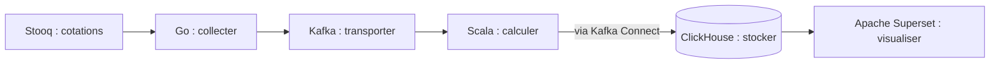
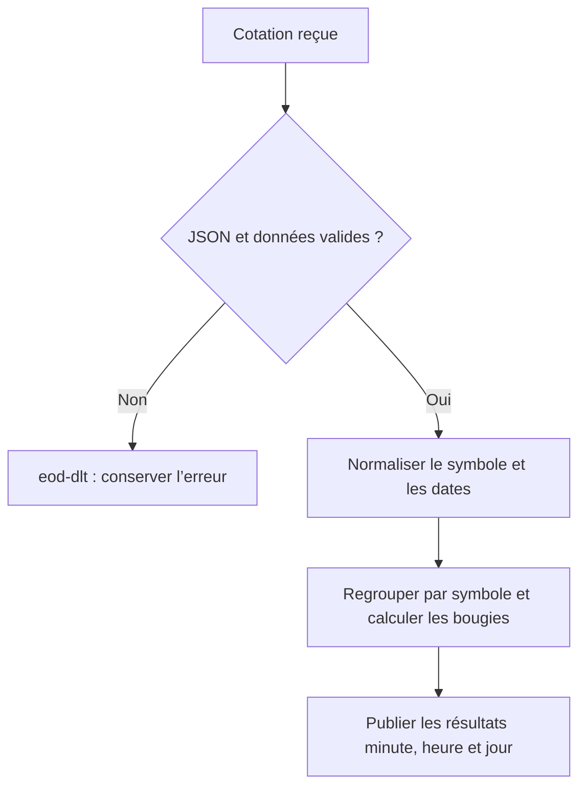

# StreamLoom

StreamLoom collecte des cotations boursières, les transforme en résumés par minute, par heure et par jour, puis permet de les consulter dans Apache Superset.

Une **bougie OHLCV** contient le prix d’ouverture, le plus haut, le plus bas, le prix de clôture et le volume d’une période.

## Le projet en un schéma



Go et Scala tournent dans deux terminaux. Docker lance les services locaux. ClickHouse Cloud est une instance externe à configurer pour le stockage et les graphiques.

## Se repérer dans les dossiers

```text
StreamLoom/
├── apps/                       # Les deux applications
│   ├── producer/               # Go : collecte Stooq et envoi vers Kafka
│   │   ├── main.go
│   │   └── go.mod
│   └── processor/             # Scala : validation et calcul des bougies
│       ├── build.sbt
│       ├── project/            # Version de sbt et plugins
│       └── src/
│           ├── main/scala/      # Code de l’application
│           └── test/           # Tests unitaires et scénarios BDD
├── infra/                      # Configuration des services
│   ├── kafka-connect/          # Dockerfile et connecteur ClickHouse
│   └── superset/               # Image, configuration et dashboard
├── docs/                       # Configuration et explications du code
├── .env.example                # Modèle de connexion ClickHouse
├── docker-compose.yml          # Services Docker locaux
└── Makefile                    # Commandes à lancer depuis la racine
```

| Je veux… | Je vais dans… |
| --- | --- |
| Modifier la collecte ou les symboles | [apps/producer](apps/producer) |
| Modifier la validation ou les calculs | [apps/processor](apps/processor) |
| Lire les scénarios métier en français | [cotations.feature](apps/processor/src/test/resources/features/cotations.feature) |
| Configurer ClickHouse et Apache Superset | [docs/configuration.md](docs/configuration.md) |
| Comprendre le code et les tests | [docs/developpement.md](docs/developpement.md) |

## Démarrer le pipeline local

Prérequis : **Docker Compose**, **Go 1.21+**, **JDK 17**, **sbt**, **Python 3** et **Make**. sbt télécharge le compilateur Scala et les dépendances lors du premier lancement.

Toutes les commandes `make` se lancent depuis la racine du projet. `make help` affiche les commandes disponibles.

### 1. Lancer Kafka et Superset

```bash
make up
make topics
```

`make up` génère les secrets Superset manquants dans `.env`, puis démarre ZooKeeper, Kafka, Kafka UI et Superset avec sa base PostgreSQL. La commande attend aussi que Superset soit prêt. Attendre que Kafka soit prêt avant `make topics` ; si la commande échoue pendant le démarrage du broker, la relancer. La création des cinq topics peut être répétée sans les recréer.

### 2. Lancer l’agrégateur Scala

Dans un premier terminal :

```bash
make processor
```

### 3. Lancer le producteur Go

Dans un deuxième terminal :

```bash
make producer
```

Par défaut, il collecte `AAPL.US` et `MSFT.US` toutes les 5 secondes. Pour choisir les symboles et l’intervalle :

```bash
make producer SYMBOLS=AAPL.US POLL_INTERVAL=10s
```

### 4. Observer les résultats

Ouvrir [Kafka UI](http://localhost:8080) pour lire les topics :

| Topic | Contenu |
| --- | --- |
| `eod` | Cotations reçues |
| `eod-agg-1m` | Bougies par minute |
| `eod-agg-1h` | Bougies par heure |
| `eod-agg-daily` | Bougies par jour |
| `eod-dlt` | Messages invalides avec leur erreur |

Les bougies sont publiées après fermeture de la fenêtre et du délai de grâce : 1 minute pour les fenêtres minute, 5 minutes pour les fenêtres horaires et journalières. Le temps du flux avance avec les messages reçus ; attendre sans recevoir de nouveaux messages ne ferme pas une fenêtre.

## Que devient une cotation ?



Les fenêtres suivent les timestamps Kafka. Les volumes reçus sont additionnés, y compris les cotations répétées. Les règles détaillées et un exemple JSON sont dans le [guide de développement](docs/developpement.md).

## Lancer les tests

```bash
make test        # Tous les tests Scala et vérification du producteur Go
make test-unit   # Tests unitaires et de topologie et vérification Go
make test-bdd    # Scénarios Cucumber en français uniquement
```

Les tests fonctionnent sans Docker, Stooq ou ClickHouse. Le flux Kafka est simulé en mémoire. Le module Scala comprend **36 tests unitaires et de topologie** et **6 scénarios BDD** ; le producteur Go ne contient pas encore de tests dédiés.

Pour exécuter les tests Scala, générer le JAR dans `apps/processor/target/scala-2.13/` et compiler le binaire Go dans `build/producer` :

```bash
make build
```

## Ajouter le stockage et les graphiques

1. Copier `.env.example` vers `.env` si ce fichier n’existe pas, puis renseigner les identifiants ClickHouse Cloud.
2. Créer les tables ClickHouse décrites dans le [guide de configuration](docs/configuration.md#stockage-dans-clickhouse-cloud).
3. Lancer `make connect`, puis `make connector` quand l’API Kafka Connect est disponible. L’enregistrement du connecteur est à effectuer une seule fois.
4. Lancer `make superset`, puis `make superset-setup` pour créer la connexion ClickHouse, les datasets et le dashboard. Les secrets locaux sont générés dans `.env` sans écraser les valeurs existantes.

| Service | Adresse locale |
| --- | --- |
| Kafka | `localhost:9092` |
| Kafka UI | <http://localhost:8080> |
| Kafka Connect | <http://localhost:8083> |
| Apache Superset | <http://localhost:8088> |

Se connecter avec `admin` et la valeur `SUPERSET_ADMIN_PASSWORD` du fichier `.env`. Le [guide de configuration](docs/configuration.md#tableaux-de-bord-apache-superset) détaille les datasets et les graphiques.

## Arrêter et diagnostiquer

`Ctrl+C` arrête les applications Go et Scala dans leurs terminaux.

```bash
make down       # Arrêter les services Docker en conservant les volumes Kafka
make logs       # Suivre les logs des services Docker
```

Les dashboards et les connexions Superset sont conservés dans un volume PostgreSQL. Garder aussi les secrets du fichier `.env`. Les commandes détaillées et les pistes de diagnostic sont dans [docs/configuration.md](docs/configuration.md#arrêt-et-diagnostic).
