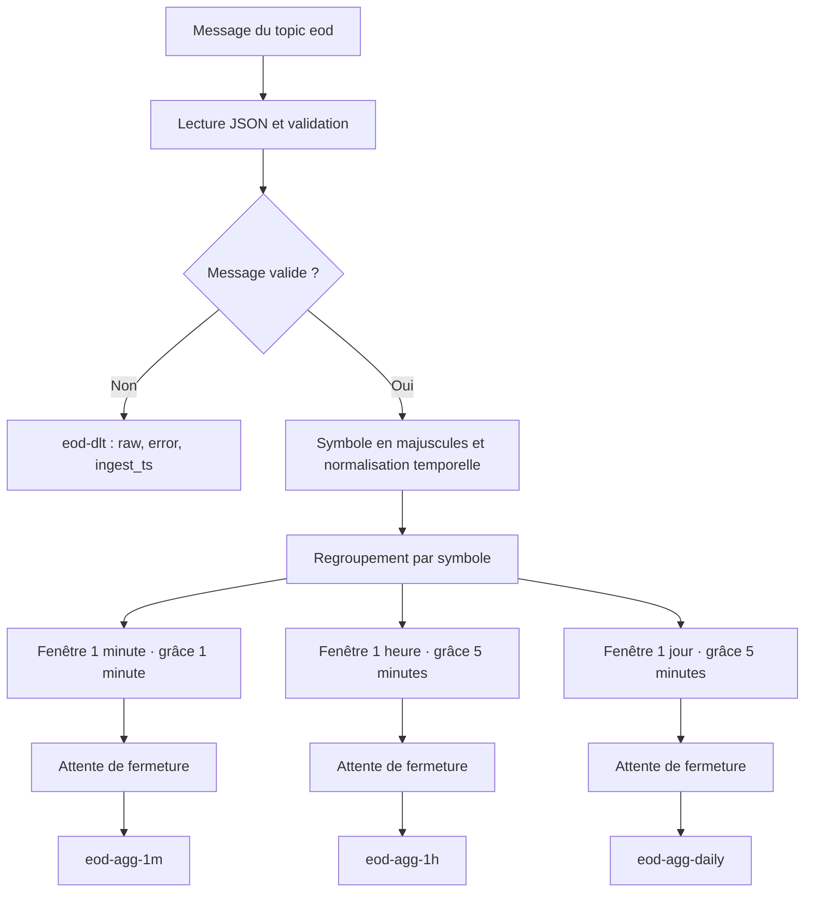

# Comprendre le code et les tests

[Retour au README](../README.md) · [Configurer les services](configuration.md)

## Où commencer dans le code ?

Le projet contient deux applications indépendantes. Le producteur collecte les cotations ; l’agrégateur les valide et calcule les bougies OHLCV.

| Fichier | Responsabilité |
| --- | --- |
| [apps/producer/main.go](../apps/producer/main.go) | Options CLI, collecte CSV Stooq et publication Kafka |
| [App.scala](../apps/processor/src/main/scala/streamloom/eod/App.scala) | Démarrage et arrêt de Kafka Streams |
| [StreamConfig.scala](../apps/processor/src/main/scala/streamloom/eod/StreamConfig.scala) | Variables d’environnement et valeurs par défaut |
| [QuoteTopology.scala](../apps/processor/src/main/scala/streamloom/eod/QuoteTopology.scala) | Parcours des messages entre les topics |
| [QuoteParser.scala](../apps/processor/src/main/scala/streamloom/eod/QuoteParser.scala) | Lecture JSON, validation et normalisation |
| [Quote.scala](../apps/processor/src/main/scala/streamloom/eod/Quote.scala) | Cotation et message d’erreur |
| [OhlcvState.scala](../apps/processor/src/main/scala/streamloom/eod/OhlcvState.scala) | Calcul des bougies et format des agrégats |
| [Json.scala](../apps/processor/src/main/scala/streamloom/eod/Json.scala) | Sérialisation JSON pour Kafka et ClickHouse |

Pour suivre une cotation, lire `QuoteTopology.scala`, puis `QuoteParser.scala` et `OhlcvState.scala`. Les classes Scala restent dans un seul package, `streamloom.eod`, pour garder la navigation courte.

## Traitement et données




Exemple de cotation d’entrée :

```json
{
  "symbol": "AAPL.US",
  "date": "2026-11-12",
  "time": "15:30:00",
  "open": 225.0,
  "high": 226.5,
  "low": 224.8,
  "close": 226.0,
  "volume": 1000,
  "source": "stooq",
  "fetched_at": "2026-11-12T15:30:05Z"
}
```

Les agrégats contiennent notamment `symbol`, `window_start`, `window_end`, `window_label`, `open`, `high`, `low`, `close`, `volume_sum`, `count`, `source`, `first_event_time_ms`, `last_event_time_ms` et `ingest_ts`.

Comportements à connaître :

- La validation rejette notamment les messages illisibles, les symboles ou dates/heures absents, les valeurs OHLC `NaN` et les volumes négatifs.
- La normalisation interprète `date` et `time` en UTC, avec repli sur `fetched_at`, puis sur l’heure courante si le parsing échoue.
- Les fenêtres utilisent le timestamp Kafka des messages, conservé pendant la normalisation. `event_time_ms` sert aux métadonnées de l’agrégat.
- Les trois séries sont calculées directement à partir des cotations : `1m` (grâce 1 minute), `1h` (grâce 5 minutes) et `1d` (grâce 5 minutes). Les heures sont fixes en UTC, de `HH:00:00` à l’heure suivante, borne de fin exclue.
- `open` provient du premier message traité, `close` du dernier, `high` et `low` des extrêmes. `volume_sum` additionne les volumes reçus, y compris ceux de cotations répétées ; aucune déduplication n’est implémentée.

## Tests unitaires et BDD


Le module utilise Scala 2.13, JUnit 5 pour les tests unitaires et [Cucumber](https://cucumber.io/docs/installation/java/) pour les scénarios BDD. sbt télécharge le compilateur Scala : aucune installation de Scala n’est nécessaire sur la machine.

Lancer tous les tests, sans Docker ni connexion à Stooq ou ClickHouse :

```bash
cd apps/processor
sbt test
```

Pour séparer les tests unitaires des scénarios BDD :

```bash
# Tests unitaires et tests de topologie
sbt unitTest

# Scénarios BDD uniquement
sbt bddTest

# Une seule classe de tests unitaires
sbt 'testOnly *QuoteParserTest'
```

| Fichier sous `apps/processor/` | Ce qu’il vérifie |
| --- | --- |
| `src/test/scala/streamloom/eod/QuoteParserTest.scala` | JSON, validation, symbole en majuscules et dates de repli |
| `src/test/scala/streamloom/eod/OhlcvStateTest.scala` | Ouverture, clôture, extrêmes, volume et compteur |
| `src/test/scala/streamloom/eod/JsonSerdeTest.scala` | Aller-retour JSON et noms de champs attendus par ClickHouse |
| `src/test/scala/streamloom/eod/StreamConfigTest.scala` | Configuration par défaut et variables d’environnement |
| `src/test/scala/streamloom/eod/QuoteTopologyTest.scala` | Topics personnalisés, messages nuls, données tardives et fenêtres horaires |
| `src/test/resources/features/cotations.feature` | Six scénarios métier en français |
| `src/test/scala/streamloom/eod/bdd/QuoteSteps.scala` | Implémentation Scala des étapes BDD |

Exemple de lecture d’un scénario : **Étant donné** deux cotations, **quand** la fenêtre minute et sa grâce sont dépassées, **alors** une seule bougie contient les extrêmes et la somme des volumes attendus.

Les tests du flux utilisent [`TopologyTestDriver`](https://kafka.apache.org/36/streams/developer-guide/testing/), le simulateur Kafka Streams en mémoire. Ils font avancer les timestamps des messages, sans attente réelle. Ils vérifient la topologie et les JSON produits ; la connexion réseau et l’écriture effective dans ClickHouse nécessitent un environnement d’intégration.

Les rapports JUnit XML sont générés dans `target/test-reports/` et le rapport HTML Cucumber dans `target/reports/cucumber.html`, à l’intérieur du module.

Depuis la racine, les mêmes tests sont accessibles avec `make test`, `make test-unit` et `make test-bdd`. Les tâches `make test` et `make test-unit` vérifient aussi que le producteur Go compile via `go test ./...` ; aucun test Go n’est encore défini.

Les commandes `unitTest` et `bddTest` écrivent dans ces mêmes dossiers ; les rapports correspondent aux tests exécutés.

## Ajouter un comportement

1. Écrire un exemple simple dans un test unitaire proche de la classe concernée.
2. Modifier la validation ou le calcul, puis lancer `make test-unit`.
3. Si le comportement concerne le parcours d’un message, ajouter un scénario dans `src/test/resources/features/cotations.feature`, sous `apps/processor`.
4. Ajouter ses étapes dans `QuoteSteps.scala` si elles n’existent pas déjà, puis lancer `make test-bdd`.
